# Paw Mall

Paw Mall (working name) is a mobile app for pet owners in Mexico. It answers two everyday
questions:

- **Where's the pet business I need?** Vets and vet hospitals, pet stores, boutiques, groomers,
  boarding, feed stores and more, on a map and a list, with a fast path to the nearest emergency
  vet.
- **Where can I go with my pet?** Restaurants, cafés, lodging, museums and parks with their pet
  policy (dogs or cats, size limits, terrace or indoors).

It covers all 32 states of Mexico with open data (INEGI DENUE, Overture Maps, OpenStreetMap,
Wikidata) plus hand-collected pet policies. Spanish first (`es-MX`), English alongside.

**Status:** development only. Nothing is deployed; everything runs on a developer machine. See
[docs/DEPLOYMENT.md](docs/DEPLOYMENT.md) for what's built so far.

## Quality engineering

Paw Mall's main quality risk isn't whether the app runs. It's whether the app reliably leads
people to the right pet businesses, including ones they would otherwise miss, and whether those
listings can be trusted. Quality work is organized around five pillars, defined in the
**[QA strategy](docs/QA-STRATEGY.md)** with its objectives, risk priorities, test strategy and
release gates. The table maps each pillar to its section of the strategy and to the checks that
back it today.

| Pillar                                   | Strategy                                                                 | What is verified                                                                                                                                                           | Evidence                                                                                                                                                                                                |
| ---------------------------------------- | ------------------------------------------------------------------------ | -------------------------------------------------------------------------------------------------------------------------------------------------------------------------- | ------------------------------------------------------------------------------------------------------------------------------------------------------------------------------------------------------- |
| **Search quality and relevance**         | [§4, §5](docs/QA-STRATEGY.md#5-search-quality-evaluation)                | Accent- and order-insensitive matching, place-versus-business intent, radius fitting, nearest-first ranking, consistent results across the map, list and Urgencias         | Search benchmark (`pnpm search:bench`): 41 labeled queries, precision and recall at 10 against a baseline; unit tests (`search-tokens`, `search-filter`, `search-keywords`); 11 Maestro search journeys |
| **Business-data integrity and trust**    | [§4, §6](docs/QA-STRATEGY.md#6-data-quality-and-trust)                   | Duplicate merging, coordinates inside Mexico, valid hours, Urgencias places without a phone, stale sources, cruelty-linked businesses kept out, every data source credited | `pnpm places:integrity` (read-only report on the full data); importer tests with sample files; a verification status on every place (`packages/shared/src/verification.ts`)                             |
| **API, database and mobile reliability** | [§4](docs/QA-STRATEGY.md#4-test-strategy)                                | Behavior with the database down, an interrupted import, a slow or unreachable API, no connection; performance under concurrent load                                        | `database-down.test.ts`, `denue/save.test.ts`; `offline` and `api-down` flows; k6 load test (`pnpm load`): 50 concurrent users, p95 229 ms against a 500 ms threshold                                   |
| **Security and privacy**                 | [§4, §7](docs/QA-STRATEGY.md#7-continuous-integration-and-release-gates) | Write rate limits, a cap on pending claims, CORS restricted to known origins, no personal data from reporters, secrets kept out of the repository                          | `rate-limit.test.ts` (limits and CORS), `trust.test.ts`; reporter-privacy rule in [CLAUDE.md](CLAUDE.md); keys only in git-ignored local files                                                          |
| **Continuous and AI-assisted quality**   | [§7–§9](docs/QA-STRATEGY.md#8-ai-assisted-quality-engineering)           | Every change passes lint, type checks and tests before merge; each phase has an explicit "Done when" release criterion and a recorded outcome                              | CI on every pull request; Maestro on an Android emulator (nightly or by label); [docs/DEPLOYMENT.md](docs/DEPLOYMENT.md) rollout log; standing rules in [CLAUDE.md](CLAUDE.md)                          |

**Current baseline (2026-10-14),** reproducible with `pnpm test`, `pnpm --filter mobile e2e`,
`pnpm load` and `pnpm search:bench`:

- 360 unit and API tests (shared 36, mobile 96, API 105, importers 123).
- 30 end-to-end flows covering 34 user journeys on Android, and all but one on iOS.
- Load test: p95 of 229 ms at 77 requests per second.
- Search benchmark (41 queries): precision@10 93%, recall@10 72%, zero results 5%, known items,
  negative cases and place intent 100%, p95 46 ms.

**AI-assisted development** ([QA strategy §8](docs/QA-STRATEGY.md#8-ai-assisted-quality-engineering)):
the app is built with Claude Code under written standing rules ([CLAUDE.md](CLAUDE.md)). Every change goes through a phase branch and a pull request, must pass
the same automated gates, and is merged only on the owner's explicit approval after checks pass.
Bugs found in manual review become regression flows (for example `search-pan`, `urgent-sync` and
`maps-sync` in Phase 16).

**Known gaps** (the strategy's [status table](docs/QA-STRATEGY.md#10-current-project-status)
tracks each one):

- The search benchmark's labels are drafts awaiting the owner's review, so no release thresholds
  are set yet; it runs locally on the dev data, not in CI (§5, §7). It found where search misses:
  typos, and generic words left after a service word ("hotel para perros", "urgencias
  veterinarias", "dog grooming") that must then appear in names.
- Formatting is checked locally, not in CI (§7).
- iOS runs in Expo Go rather than a development build, and the end-to-end workflow in CI has not
  run yet (§4).
- 162 Urgencias places have no phone (§6).
- Pilot requirements are not started: production database, backup and restore, monitoring and
  privacy disclosures (§7). Nothing is deployed.

## Repository

A pnpm + Turborepo monorepo:

| Path                 | What it is                                                                    |
| -------------------- | ----------------------------------------------------------------------------- |
| `apps/mobile`        | The Expo (React Native) app for iOS and Android                               |
| `apps/api`           | The Hono API (Cloudflare Workers, run locally with `wrangler dev`) and the DB |
| `packages/shared`    | Zod schemas, types and constants used by the app, the API and the importers   |
| `packages/importers` | Scripts that load and enrich the place data                                   |
| `docker/postgres`    | PostgreSQL 17 + PostGIS image                                                 |
| `docs/`              | Plan, architecture, guides and the rollout log                                |

## Quick start

Needs Node 24, pnpm, Docker and, for the app, Expo Go on a phone or the iOS simulator / Android
emulator. The full setup, including Android development builds, is in
[docs/DEVELOPMENT.md](docs/DEVELOPMENT.md).

```sh
pnpm install
pnpm db:up && pnpm db:migrate          # Postgres + PostGIS in Docker, port 5434
pnpm places:import                     # pet businesses from INEGI DENUE (and the other loaders)
pnpm --filter api dev                  # API on http://localhost:8787
pnpm --filter mobile start             # Metro; scan the QR code with Expo Go
```

## Everyday commands

| Command                                  | Does                                                             |
| ---------------------------------------- | ---------------------------------------------------------------- |
| `pnpm lint` / `pnpm typecheck`           | ESLint and TypeScript in every package                           |
| `pnpm test`                              | Vitest in every package (the API tests use `paw_mall_test`)      |
| `pnpm db:up` / `pnpm db:down`            | Start or stop the database                                       |
| `pnpm db:migrate`                        | Apply the API's migrations                                       |
| `pnpm places:*`                          | Data loaders (list in [DEVELOPMENT.md](docs/DEVELOPMENT.md))     |
| `pnpm search:bench`                      | Search quality benchmark against the baseline (local API)        |
| `pnpm --filter mobile e2e`               | Maestro end-to-end flows ([TESTING-E2E.md](docs/TESTING-E2E.md)) |
| `pnpm --filter mobile e2e:ios`           | The same flows on the iOS simulator in Expo Go                   |
| `pnpm --filter mobile android:dev`       | Build and run the Android development build                      |
| `pnpm --filter mobile emulator:location` | Set the Android emulator's GPS to this Mac's location            |

## Documentation

| Document                                       | For                                                                  |
| ---------------------------------------------- | -------------------------------------------------------------------- |
| [docs/USER-GUIDE.md](docs/USER-GUIDE.md)       | How the app works, screen by screen                                  |
| [docs/ARCHITECTURE.md](docs/ARCHITECTURE.md)   | How the pieces fit: app, API, database, data pipeline                |
| [docs/DEVELOPMENT.md](docs/DEVELOPMENT.md)     | Setting up, running, conventions and troubleshooting                 |
| [docs/TESTING-E2E.md](docs/TESTING-E2E.md)     | End-to-end flows, test data and the GitHub Actions workflows         |
| [docs/QA-STRATEGY.md](docs/QA-STRATEGY.md)     | Quality objectives, risk priorities, test strategy and release gates |
| [docs/GOOGLE-PLACES.md](docs/GOOGLE-PLACES.md) | Google "Ver horario" and the Android Maps key                        |
| [docs/PLAN.md](docs/PLAN.md)                   | The build plan, phase by phase, and open decisions                   |
| [docs/DEPLOYMENT.md](docs/DEPLOYMENT.md)       | The rollout log: what each phase and PR delivered                    |
| [CLAUDE.md](CLAUDE.md)                         | Standing rules for working in this repo                              |

## Screenshots

Taken on 2026-10-14 in Colonia Condesa, Mexico City, with the full development data. Android is
the release build on the emulator (Pixel 10, Google Maps); iOS is Expo Go on the simulator
(iPhone 17 Pro Max, Apple Maps). [docs/USER-GUIDE.md](docs/USER-GUIDE.md) describes each screen.

| Screen                                                                     | Android                                                             | iOS                                                             |
| -------------------------------------------------------------------------- | ------------------------------------------------------------------- | --------------------------------------------------------------- |
| **Explorar, map:** pet businesses within the radius, grouped into clusters | 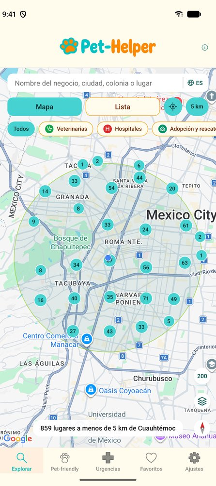          | 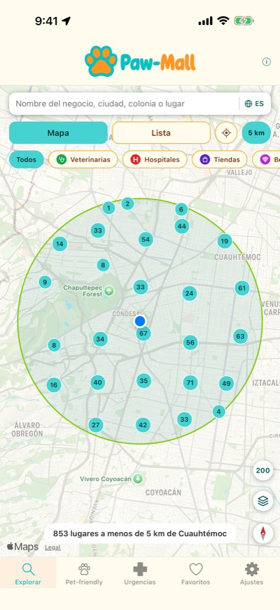          |
| **Explorar, list:** nearest first, with category, address and contact      | 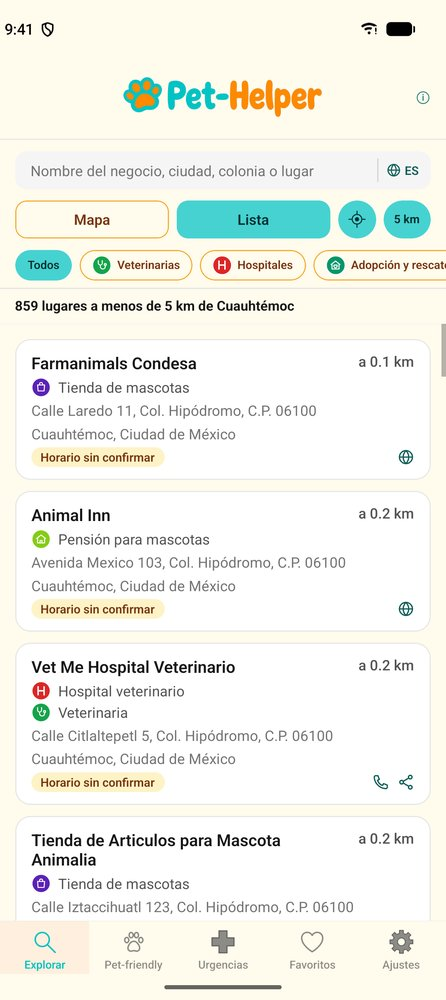         | 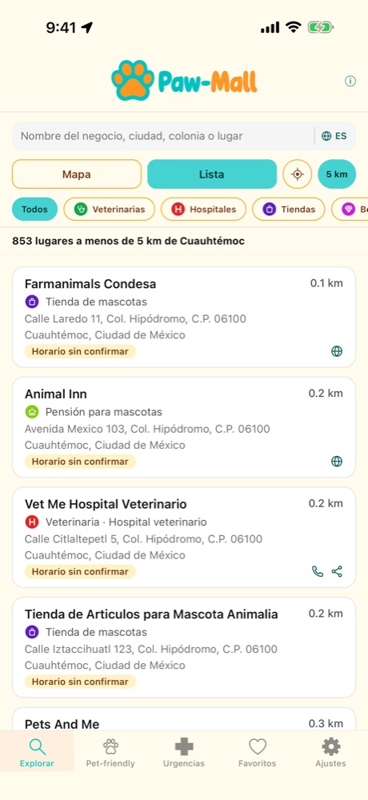         |
| **Place page:** verification, directions, website, hours and reports       | 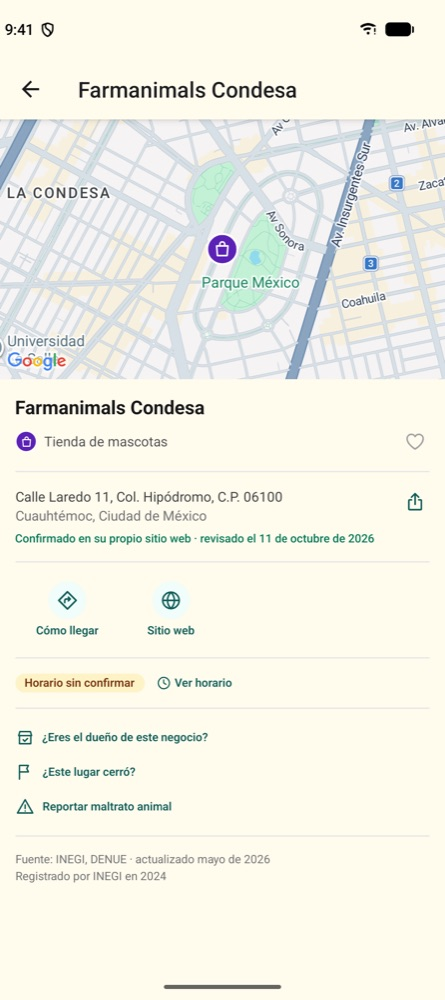        | 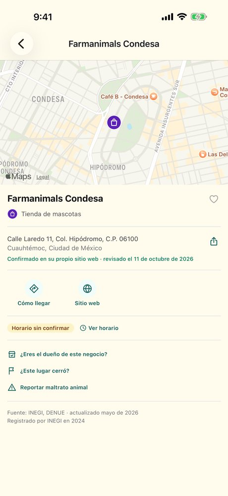        |
| **Pet-friendly:** parks, restaurants, cafés and lodging with their policy  | 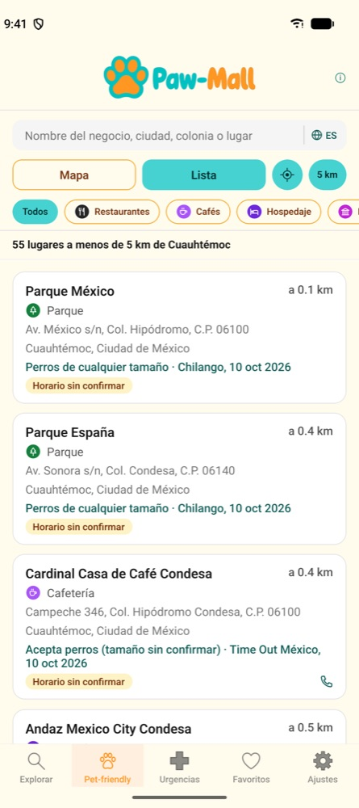 | 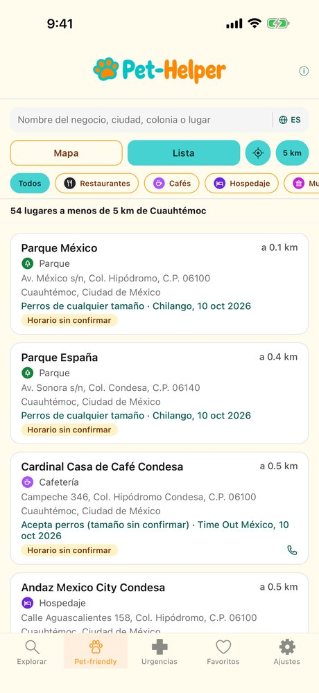 |
| **Urgencias:** vet hospitals nearest first, with call and share            | 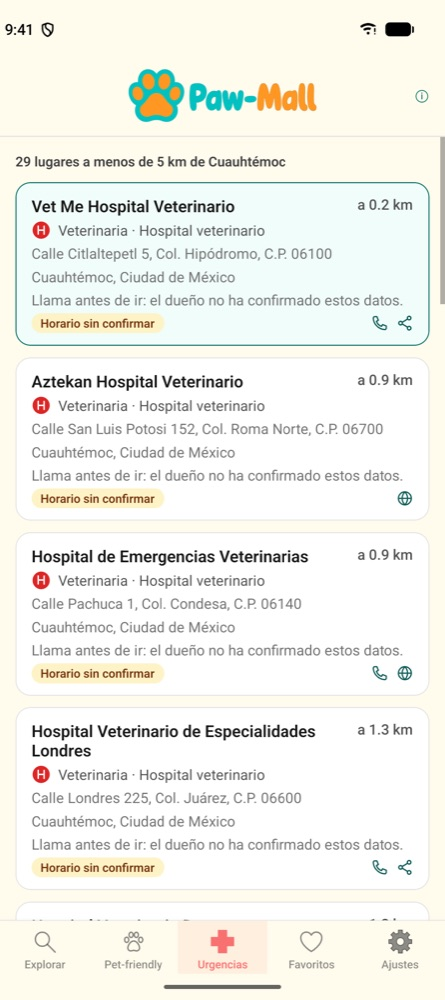       | 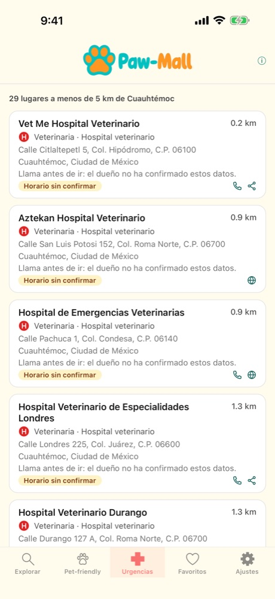       |
| **Ajustes:** language, distance units, pet and listing filters             | 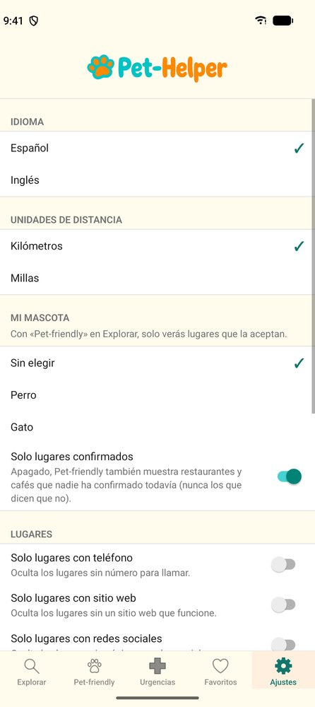     | 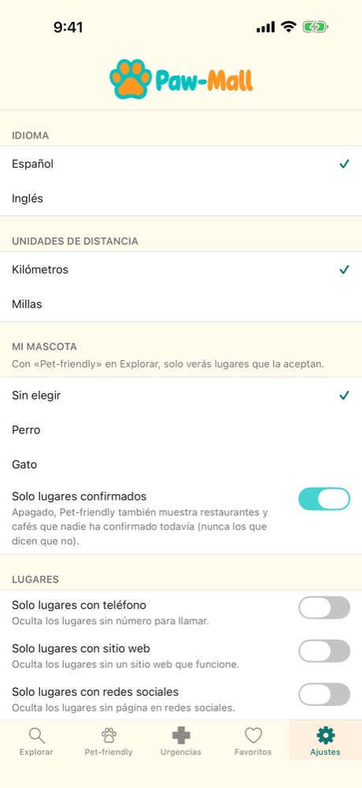     |

## Data sources

Business data: INEGI, Directorio Estadístico Nacional de Unidades Económicas (DENUE). Phones,
websites and social media: Overture Maps Foundation. Landmarks: Wikidata. Dog parks, venues,
hours and some vets' phones: © OpenStreetMap contributors (ODbL). Pet policies: hotel chains' and businesses' own
websites, the press and Paw Mall users. Hours on request: Google Maps. Each source is credited
in the app wherever its data appears.
